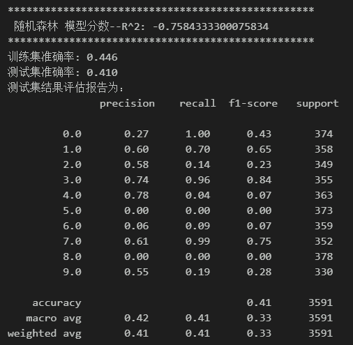
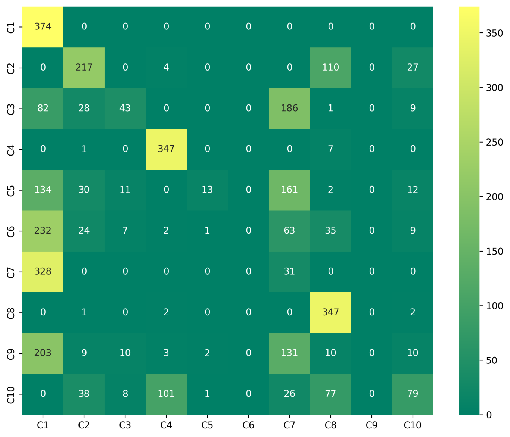
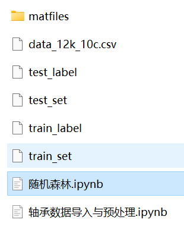

# Bearing Fault Diagnosis - Random Forest Fault Classification Model

The dataset includes a complete CWRU bearing fault dataset, as well as fault signal datasets, classification data, and label sets that have been generated. The corresponding code can be run.
It also includes preprocessing codes for the data and random forest classification codes.
Environment: Python 3.9, PyTorch 1.8 or above.
Fault classification confusion matrix:
Previously excellent content:
Python-Kaiser Permanente University (CWRU) Bearing Data Interpretation and Classification Processing
Python Bearing Fault Diagnosis (I) Short-Time Fourier Transform STFT
Python Bearing Fault Diagnosis (II) Continuous Wavelet Transform CWT
Python Bearing Fault Diagnosis (III) Empirical Mode Decomposition EMD
Pytorch-LSTM Bearing Fault One-Dimensional Signal Classification (I)
Pytorch-CNN Bearing Fault One-Dimensional Signal Classification (II)
Pytorch-Transformer Bearing Fault One-Dimensional Signal Classification (III)
Python Bearing Fault Diagnosis (IV) Based on EMD-CNN Fault Classification
Python Bearing Fault Diagnosis (V) Based on EMD-LSTM Fault Classification
Python Bearing Fault Diagnosis (VI) Based on EMD-Transformer Fault Classification
Python Bearing Fault Diagnosis (VII) Based on EMD-CNN-LSTM Fault Classification
Python Bearing Fault Diagnosis (VIII) Based on EMD-CNN-GRU Parallel Model Fault Classification
Based on FFT + CNN - BiGRU-Attention Time-Domain, Frequency-Domain Feature Attention Fusion Bearing Fault Identification Model
Based on FFT + CNN - Transformer Time-Domain, Frequency-Domain Feature Fusion Bearing Fault Identification Model
Python Bearing Fault Diagnosis (IX) Based on VMD+CNN-BiLSTM Fault Classification
Python Bearing Fault Diagnosis (10) - Fault Classification Based on VMD+CNN-Transformer
Python Bearing Fault Diagnosis (11) - Fault Classification Based on VMD+CNN-BiGRU-Attenion
Cross Attention Fusion of Time and Frequency Features with FFT + CNN-BiLSTM-CrossAttention Bearing Fault Identification Model
Cross Attention Fusion of Time and Frequency Features with FFT + CNN-Transformer-CrossAttention Bearing Fault Identification Model
Introduction to Python Bearing Fault Diagnosis
Python Bearing Fault Diagnosis (13) - Superstrong Machine Learning Recognition Model Based on Fault Signal Feature Extraction
Python Bearing Fault Diagnosis (14) - Highly Innovative Fault Recognition Model
Python Bearing Fault Diagnosis (15) - One-Dimensional Fault Signal Recognition Model Based on CNN-Transformer
Python Bearing Fault Diagnosis (16) - Highly Innovative Fault Recognition Model (II)
SCI 1st Area Highly Innovative Bearing Fault Diagnosis Model!
Python Bearing Fault Diagnosis (18) - Innovative Diagnosis Model Based on CNN-TCN-Attention
Highly Innovative Bearing Fault Diagnosis Model Based on GADF+Swin-CNN-GAM
Attention Magic Modification | Superstrong Bearing Fault Diagnosis Model!
End
\t2. Friends who like this can click the follow button, give the article a "like", share it in WeChat groups or discuss in groups.

## Images

<!-- PAYMENT_BLOCK -->

## Get this dataset

- Payment link (Stripe): [Buy now](https://buy.stripe.com/3cs8yP7sY87d0vu9AB)
- Payment QR code: 

<!-- /PAYMENT_BLOCK -->
